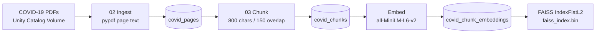
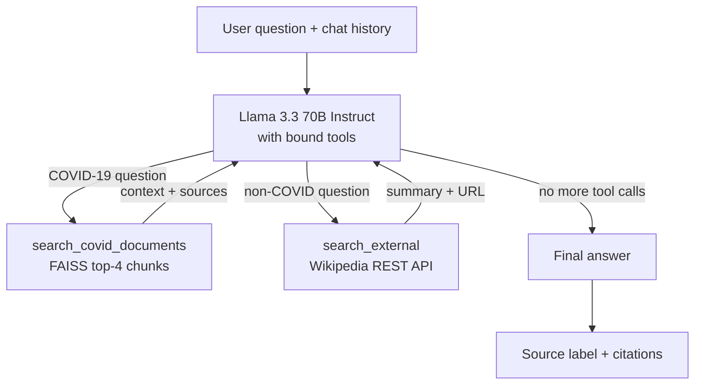

# 🦠 COVID-19 RAG Chatbot (Agentic, on Databricks)

A retrieval-augmented generation (RAG) chatbot that answers COVID-19 questions from a library of medical PDF documents, built end to end on **Databricks**.

Instead of hard-coded routing rules, an **LLM agent** (Llama 3.3 70B Instruct via Databricks Foundation Model APIs) decides for each question whether to:

- 📄 search the **internal COVID-19 knowledge base** (FAISS vector index over the PDFs),
- 🌐 look up **external general knowledge** (Wikipedia) for non-COVID questions, or
- 💬 answer **directly** (greetings, small talk, or questions about the conversation itself).

Every answer is labeled with the source it actually came from and returned with citations.

---

## ✨ Features

- **PDF ingestion** from a Unity Catalog Volume, with page-level text and metadata
- **Chunking** with LangChain's `RecursiveCharacterTextSplitter` (800 characters, 150 overlap)
- **Embeddings** with `all-MiniLM-L6-v2` (384-dimensional) from Sentence Transformers
- **Vector search** with a FAISS `IndexFlatL2` (exact nearest-neighbour search, top-4 chunks)
- **Agentic tool calling**: the LLM chooses none, one, or both tools per question, with a 3-round safety limit
- **Deterministic source labels**: the label is set in code from the tools that were actually called, not written by the LLM
- **Citations**: file name and page number for internal answers; article title and URL for Wikipedia answers
- **Conversation memory**: follow-ups such as *"What are the symptoms of it?"* resolve against earlier turns
- **MLflow tracking**: LangChain autologging plus evaluation runs in the `/Shared/covid_rag_experiments` experiment

---

## 🏗️ Architecture

### Offline pipeline: building the knowledge base



### Online: the agent loop



---

## 🧰 Tech Stack

| Layer | Tool |
|---|---|
| Platform | Databricks (notebooks, Unity Catalog tables and Volumes) |
| PDF parsing | `pypdf` |
| Chunking | `langchain-text-splitters` |
| Embeddings | `sentence-transformers` (`all-MiniLM-L6-v2`) |
| Vector index | `faiss-cpu` |
| LLM | `databricks-meta-llama-3-3-70b-instruct` via `databricks-langchain` (`ChatDatabricks`) |
| Agent / tools | `langchain-core` (`@tool`, `bind_tools`, message types) |
| External knowledge | Wikipedia REST API (`/page/summary`) |
| Experiment tracking | MLflow |
| Data handling | `pandas`, Spark |

---

## 📁 Repository Structure

```
covid_rag_chatbot/
├── 01_setup.ipynb               # Installs all project dependencies
├── 02_ingest_pdfs.ipynb         # Extracts page text from PDFs → covid_pages table
├── 03_chunk_embed_index.ipynb   # Chunks, embeds, and builds the FAISS index
├── 04_rag_chain.ipynb           # Tools, agent loop, labeling, and chat interface
└── 05_evaluation.ipynb          # Evaluation set, metrics, and MLflow logging
```

---

## 🗄️ Data and Storage (Unity Catalog)

| Object | Type | Created by | Contents |
|---|---|---|---|
| `/Volumes/main/covid_rag/covid_docs/` | Volume | You (upload) | Source COVID-19 PDFs |
| `main.covid_rag.covid_pages` | Table | `02` | `source_file`, `page_num`, `text`, `source_path` |
| `main.covid_rag.covid_chunks` | Table | `03` | Page metadata + `chunk_id`, `chunk_text` |
| `main.covid_rag.covid_chunk_embeddings` | Table | `03` | Chunks + `embedding` vector |
| `faiss_index.bin` | File in Volume | `03` | Serialized FAISS index |
| `chunk_metadata.pkl` | File in Volume | `03` | Chunk DataFrame (text + source info) |
| `evaluation_results.csv` | File in Volume | `05` | Per-question evaluation results |

Pages with 50 characters of text or fewer (blank or image-only pages) are dropped during ingestion. Each chunk gets an ID in the form `<file>_p<page>_c<chunk>`.

---

## 🚀 Getting Started

### Prerequisites

- A Databricks workspace with **Unity Catalog** enabled
- Access to the Foundation Model APIs endpoint **`databricks-meta-llama-3-3-70b-instruct`** (the agent needs an endpoint that supports function calling)
- A cluster with internet access, for `pip` installs, downloading the embedding model from Hugging Face, and calling the Wikipedia API
- Permission to create a schema and volume in the `main` catalog (or change the paths in the notebooks)

### 1. Create the schema and volume

```sql
CREATE SCHEMA IF NOT EXISTS main.covid_rag;
CREATE VOLUME IF NOT EXISTS main.covid_rag.covid_docs;
```

### 2. Upload the PDFs

Upload your COVID-19 PDF documents to `/Volumes/main/covid_rag/covid_docs/` (Catalog Explorer → the volume → **Upload to this volume**). The PDFs need a text layer: `pypdf` extracts embedded text and does not OCR scanned pages.

### 3. Import the notebooks

Clone this repo into a Databricks Git folder, or import the `.ipynb` files through **Workspace → Import**.

### 4. Run the notebooks in order

| Step | Notebook | What it does |
|---|---|---|
| 1 | `01_setup` | Installs all dependencies |
| 2 | `02_ingest_pdfs` | Reads every PDF in the volume and saves page text to `covid_pages` |
| 3 | `03_chunk_embed_index` | Chunks pages, generates embeddings, and writes the FAISS index and metadata to the volume |
| 4 | `04_rag_chain` | Loads the index, sets up the LLM, tools, and agent, and starts the chat interface |
| 5 | `05_evaluation` | Runs the evaluation set and logs results to MLflow |

Each notebook also installs the packages it needs and restarts Python, so they can be re-run individually.

### 5. Chat with the bot

After running `04_rag_chain`, use these functions in any new cell:

```python
chat("What is COVID-19 and how does it spread?")   # uses the internal documents
chat("What are the symptoms of it?")               # follow-up, resolved from chat history
chat("What is NLP?")                               # uses Wikipedia
chat("hey, how are you?")                          # answered directly, no tool call
chat("what was my last question?")                 # answered from conversation memory

show_history()    # print the conversation so far
clear_history()   # reset conversation memory
```

Each response is printed with its label, followed by structured sources when a tool was used:

```
📄 **[Internal — COVID-19 Documents]**

<answer text>

Sources: [
  {"source_file": "<document>.pdf", "page_num": 3},
  ...
]
```

#### Source labels

| Label | Meaning |
|---|---|
| 📄 **[Internal — COVID-19 Documents]** | Answered from the PDF knowledge base |
| 🌐 **[External Source]** | Answered from Wikipedia |
| 📄🌐 **[Internal + External Sources]** | The agent used both tools |
| *(no label)* | Answered directly, such as a greeting or a question about the chat history |

---

## 🤖 How the Agent Works

1. The system prompt, the conversation history, and the new question are sent to the LLM, which has both tools bound to it.
2. If the LLM requests a tool, the tool runs and its result goes back to the LLM as a `ToolMessage`. This repeats for up to **3 rounds**.
3. If the model is still requesting tools after 3 rounds, it is called once more **without tools** to force a final answer.
4. The answer is labeled in code based on which tools were actually called, and the collected citations are returned alongside it.
5. Any exception is caught and returned as a short apology message instead of crashing the chat.

**Tools**

| Tool | Source | Used for |
|---|---|---|
| `search_covid_documents` | FAISS index over the PDF chunks (top 4) | Any COVID-19 question: symptoms, transmission, prevention, vaccines, treatment, variants, statistics |
| `search_external` | Wikipedia page-summary API | Questions that are not about COVID-19 |

**System prompt behaviour**

- Acts as a COVID-19 assistant and introduces itself that way on greetings
- Answers only from tool results and the conversation history, and says so plainly when a tool returns nothing useful
- After answering a non-COVID question, briefly steers the conversation back to COVID-19
- Keeps answers conversational, with no tool-related meta-commentary (the application adds the label)

---

## 📊 Evaluation

`05_evaluation.ipynb` runs a 12-question test set and logs everything to MLflow under `/Shared/covid_rag_experiments`.

**Test set**

| Questions | Expected route | Types |
|---|---|---|
| Q1–Q9 | Internal | fact, definition, guidance, comparison, summary |
| Q10–Q12 | External | fallback (travel restrictions, 2026 case counts, airline policy changes) |

**Automatic metrics**

- `route_accuracy`: share of questions answered from the expected source
- `avg_total_latency_sec`: mean end-to-end time (retrieval + generation)
- `internal_route_rate` and `external_route_rate`

The full results table is logged to MLflow as `evaluation_results.json` and saved to the volume as `evaluation_results.csv`.

**Manual rubric (1–5)**

A template adds columns for human scoring of each answer:

- `relevance_score`: does the answer address the question?
- `grounded_score`: is it supported by the retrieved context?
- `retrieval_score`: were the right chunks retrieved?
- `overall_score`: overall answer quality

After the scores are filled in, an optional nested MLflow run (`covid_rag_manual_scores`) logs the averages.

---

## ⚠️ Limitations and Future Work

- **Static knowledge base**: answers are only as current as the uploaded PDFs.
- **Text-only extraction**: scanned PDFs, tables, and figures are not handled. OCR or `pdfplumber` table parsing could help.
- **Exact search**: `IndexFlatL2` works well for a small corpus. A larger one would benefit from an approximate index (IVF/HNSW) or Databricks Vector Search.
- **Simple Wikipedia lookup**: the external tool uses the query directly as an article title, so it works best for short topic-style queries. Calling the Wikipedia search API first would make it more robust.
- **Notebook-only interface**: a natural next step is deploying the agent with Databricks Model Serving or a Databricks App with a chat UI.

---

## 📌 Disclaimer

This project is for educational purposes only. Its answers are not medical advice. For health decisions, consult a qualified healthcare professional or official public health sources.

---

## 👤 Author

[ArtiMakwana1](https://github.com/ArtiMakwana1)
